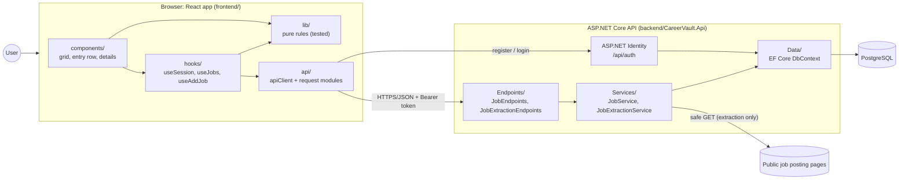
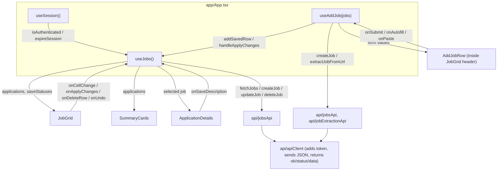
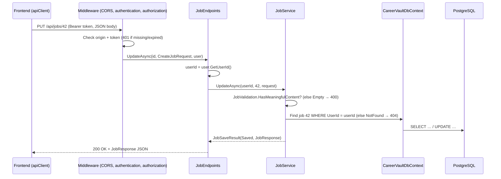
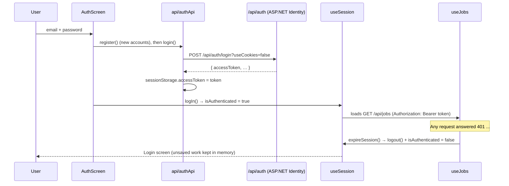
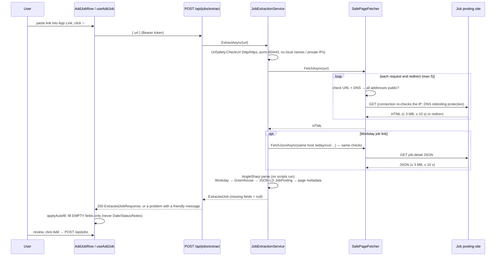
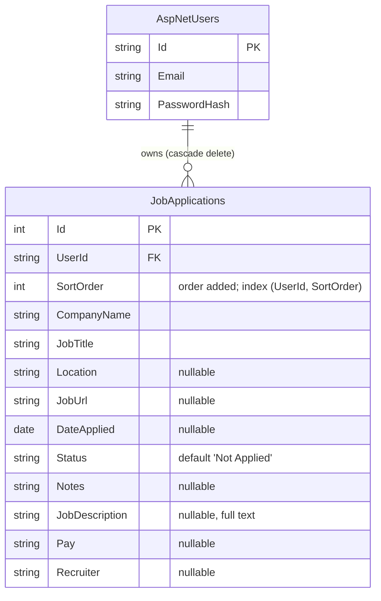

# CareerVault architecture

This document explains how CareerVault is put together and why. For setup
instructions see the [README](../README.md); for where to add code see
[CONTRIBUTING.md](../CONTRIBUTING.md).

## 1. Overall architecture

Two programs talk over HTTP:

- **Frontend** (`frontend/`): a single-page React app. It never talks to the
  database or to job sites directly.
- **Backend** (`backend/CareerVault.Api`): an ASP.NET Core API using **Minimal
  APIs**. It owns all data rules, authentication and all outbound requests.

## 2. Frontend

### Folder responsibilities

| Folder | Responsibility | Examples |
|--------|----------------|----------|
| `app/` | Puts the page together; owns only search text and which details dialog is open | `App.tsx` |
| `components/` | Drawing UI and handling clicks/keys. No API calls. | `jobs/JobGrid.tsx`, `jobs/AddJobRow.tsx`, `jobs/ApplicationDetails.tsx`, `layout/Sidebar.tsx` |
| `hooks/` | Stateful behaviour shared by components | `useSession` (login state), `useJobs` (rows, autosave, delete, undo), `useAddJob` (entry row, autofill) |
| `api/` | Every HTTP request, with typed results | `apiClient.ts`, `jobsApi.ts`, `authApi.ts`, `jobExtractionApi.ts` |
| `lib/` | Pure functions with no React: the rules, each with a `*.test.ts` next to it | `jobRows.ts` (save/delete decisions, merge), `pasteParsing.ts`, `gridClipboard.ts`, `spreadsheetEdits.ts` (undo), `keyboardNav.ts`, `autofill.ts` |
| `types/` | Shared TypeScript types | `job.ts` |
| `styles/` | Global tokens and page layout CSS (component CSS sits next to its component) | `index.css`, `layout.css` |

The rule of thumb: **if it can be a plain function, it goes in `lib/` and gets
a test**; hooks connect those functions to React state and the API;
components only render and forward user actions.

### Frontend data flow

### How autosave works (`hooks/useJobs.ts` + `lib/jobRows.ts`)

Each row has a frontend-only `rowKey` (it never changes, even when a new row
gets its database id) and bookkeeping in `rowSync`:

| Field | Meaning |
|-------|---------|
| `dbId` | Database id, or `null` before the first save |
| `version` | Goes up on every edit |
| `savedVersion` | The newest version the API has confirmed |
| `isSaving` | A request for this row is running |
| `isDeleting` | The row is being deleted; it will never be saved again |

`decideSave` (in `lib/jobRows.ts`) turns that into one of: skip, wait, empty
(don't store), POST or PUT. Rules that follow from it:

- One request per row at a time; when it finishes, it saves again if the user
  kept typing (`version > savedVersion`).
- Only the id is taken from a response, so a slow response can never undo
  newer edits.
- Creating requests go through a queue (`createTaskQueue`) so the server gives
  them `SortOrder`s in grid order.
- On 401 the session ends (see below) but nothing is thrown away. After logging
  in again, `planMerge` combines the server's rows with local unsaved work and
  the pending saves are retried with the new token. Work is only recovered for
  the same account (checked with `/api/auth/manage/info`).

## 3. Backend

### Folder responsibilities

| Folder | Responsibility |
|--------|----------------|
| `Program.cs` | Setup only: services, CORS, authentication, endpoint mapping |
| `Endpoints/` | HTTP in/out. Read the user id, call a service, map the result to a status code |
| `Services/Jobs/` | `JobService`: job rules (account isolation, empty-job rejection, `SortOrder`, entity ↔ DTO mapping) |
| `Services/JobExtraction/` | Reading job postings: URL safety, safe fetching, HTML parsing, extractors |
| `DTOs/` | The JSON contracts (`CreateJobRequest`, `JobResponse`, `ExtractJobRequest`, `ExtractedJobResponse`) |
| `Models/` | EF Core entities (`JobApplication`) |
| `Identity/` | `ApplicationUser` and `ClaimsPrincipal.GetUserId()` |
| `Data/` | `CareerVaultDbContext` (relationships, indexes) |
| `Validation/` | `JobValidation.HasMeaningfulContent` (shared "is this job empty?" rule) |
| `Migrations/` | Schema history (generated by `dotnet ef`) |

A single API project is deliberate: the app is small enough that separate
Domain/Application/Infrastructure projects would add ceremony without making
anything clearer. The folders above give the same separation within one project.

### Backend request flow

## 4. Authentication flow

Tokens are ASP.NET Identity bearer tokens (not cookies), so CORS only needs to
allow the `Authorization` header. Refresh tokens are not used yet: when the
access token expires, the user logs in again.

## 5. Job URL extraction and autofill

Design points:

- **Nothing is saved during extraction.** The user always reviews and clicks Add.
- **Nothing is invented.** Fields the page doesn't state stay empty.
- **Extensible.** Extractors run in order and earlier ones win; later ones
  only fill empty fields:
  1. `WorkdayJobPostingExtractor` (an `IAsyncJobPostingExtractor`): for
     `{tenant}[.wdN].myworkdayjobs.com` job links it builds Workday's public
     job-detail address (`/wday/cxs/{tenant}/{site}/job/{posting}`) **only from
     the validated page URL** (same host, checked path parts) and requests it
     with `IPageFetcher.FetchJsonAsync`, which applies every check below.
  2. `GreenhouseJobPostingExtractor`: Greenhouse job-board hosts only; reads
     the page's embedded job data, then its HTML.
  3. JSON-LD, then 4. page metadata.

  Both site-specific extractors fall back to `CompensationTextParser` for pay
  written only in the description. New extractors are registered in
  `JobExtractionServiceCollectionExtensions`. Apart from Workday's one JSON
  request (through the safe fetcher), extractors only parse the page that
  was already downloaded.
- **SSRF protection** (the server fetches user-supplied URLs): only http/https
  on ports 80/443; no `user:pass@`; `localhost`, `*.local`, `*.internal` and
  single-word hosts refused; every resolved address must be public (private,
  loopback, link-local incl. `169.254.169.254`, CGNAT, multicast, reserved,
  IPv4-in-IPv6 and NAT64 forms are blocked); redirects are followed manually
  and checked; the socket connection re-resolves and re-checks the address;
  no proxy, no cookies; 3 MB / 10 s limits; HTML only. Errors are generic and
  logs contain only the host.

## 6. Database relationships

ASP.NET Identity also creates its own tables (roles, claims, logins, tokens),
which CareerVault doesn't use directly.

## 7. Important design decisions

| Decision | Why |
|----------|-----|
| Minimal APIs in `Endpoints/` instead of controllers | Less boilerplate for a small API; one file per area keeps endpoints easy to find. |
| One backend project | Clean separation through folders without multi-project ceremony. |
| Pure logic in `frontend/src/lib/` | The tricky rules (merge, autosave decisions, paste mapping, undo) are tested without a browser or React. |
| Frontend-only `rowKey` per row | A row keeps its identity (and the cursor) when its temporary id becomes a database id. |
| Whole-row PUT instead of per-field PATCH | Simple and idempotent; combined with per-row versions it can't lose newer edits. |
| `SortOrder` column instead of ordering by `Id` | Explicit, survives future features like manual reordering. |
| Empty jobs rejected on the backend *and* avoided on the frontend | The database stays clean even if the API is called directly. |
| Server-side extraction with SSRF guards | Browsers can't fetch other sites (CORS), and the server must never be tricked into reaching internal addresses. |
| AngleSharp with scripting off | Reliable HTML parsing without ever executing page JavaScript. |
| Tokens in `sessionStorage` | Logged in per tab; closing the tab logs out. Simple and avoids long-lived tokens. |

## 8. Known limitations / technical debt

- `hooks/useJobs.ts` (~850 lines) and `components/jobs/JobGrid.tsx` (~900 lines)
  are still the largest files. They're cohesive (they share one set of row
  state / selection state), but are the first candidates for further
  splitting, e.g. moving the grid's keyboard handling into a hook.
- Component-level behaviour (clicks, focus, the dialog) has no automated
  tests; only the pure `lib/` and `api/` code and the backend are tested.
- `API_BASE_URL` is a constant in `frontend/src/api/config.ts`, not an
  environment variable.
- No refresh tokens; no rate limit on `/api/jobs/extract`.
- Extraction has not been verified against real job boards; pages that need
  JavaScript to render or that block bots can't be read.
